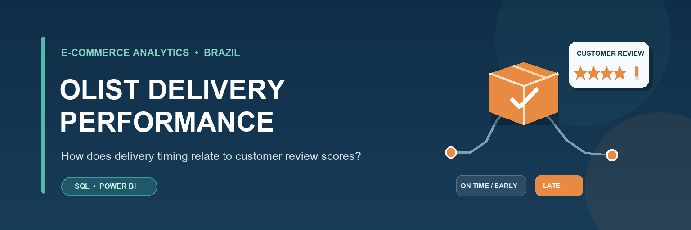

# Brazilian E-Commerce Delivery Performance & Customer Satisfaction

A portfolio project using PostgreSQL and Power BI to explore how delivery timing relates to customer review scores in the Brazilian E-Commerce Public Dataset by Olist.

## Dashboard preview

[Open the dashboard PDF](OLIST%20DELIVERY%20PERFORMANCE.pdf)

## Project question

Do delivered orders that arrive on time or early receive different average review scores from orders that arrive late?

This project compares delivery timing and review scores. It describes a relationship in the available data; it does not establish that delivery timing alone caused a score.

## Dataset

The project uses the [Brazilian E-Commerce Public Dataset by Olist on Kaggle](https://www.kaggle.com/datasets/olistbr/brazilian-ecommerce). It contains approximately 100,000 orders from Brazilian marketplaces from 2016 to 2018.

Tables used:

- `olist.customers` — customer location fields
- `olist.orders` — order status and purchase and delivery dates
- `olist.order_reviews` — customer review scores

The raw CSV files are kept locally and are excluded from this repository.

## Tools

- PostgreSQL — storing and querying the data
- SQL — data checks and analysis
- Visual Studio Code with SQLTools — writing and running SQL
- Power BI Desktop — dashboard and visual comparisons

## Analysis workflow

1. Loaded the Olist CSV files into PostgreSQL under the `olist` schema.
2. Checked the available tables, row counts, order statuses, and delivery dates.
3. Classified orders with both delivery dates as **On time or early** when the actual delivery date was on or before the estimated date, and **Late** when it was after.
4. Joined orders to reviews using `order_id`.
5. Compared average review scores between the delivery groups and built the Power BI dashboard.

## Key findings

- The orders table contains **99,441 orders**.
- **96,478 orders (97.02%)** have a delivered status.
- The overall average review score is **4.09 out of 5**.
- In the comparison of delivered orders with both delivery dates and a matched review, average scores were:

| Delivery group | Matched review records | Average review score |
|---|---:|---:|
| On time or early | 88,653 | 4.29 |
| Late | 7,700 | 2.57 |

The late group’s average was **1.72 points lower**. These averages describe the review records included in the SQL join and filters; they should not be read as proof that late delivery caused lower ratings.

## Responsible use and ethical considerations

- **Attribution and dataset terms:** Kaggle lists the dataset under the **CC BY-NC-SA 4.0** license. Credit Olist and review the dataset’s license terms before redistributing the data or reusing derived material. See the [dataset page](https://www.kaggle.com/datasets/olistbr/brazilian-ecommerce).
- **Privacy:** The dataset is described by its publisher as anonymized. This project reports aggregate results and does not publish customer-level rows, IDs, postal-code prefixes, or review text.
- **Avoid re-identification:** Do not try to connect anonymized records to named individuals or combine them with outside information to identify customers.
- **Interpret results carefully:** Delivery timing and review score occur together in these records, but other factors may influence a review. The analysis does not prove causation.
- **Historical scope:** The data covers 2016–2018 and should not be treated as a measure of current Olist performance or all Brazilian e-commerce.

## Repository files

- `01_inspect_data.sql` — initial data checks and order metrics
- `02_delivery_analysis.sql` — delivery-group counts and review-score comparison
- `OLIST DELIVERY PERFORMANCE.pdf` — exported dashboard
- `.gitignore` — keeps the local CSV folder and SQLTools session files out of GitHub

## Reproducing the analysis

1. Download the dataset from Kaggle and place the CSV files in a local `olist-data` folder.
2. Load the required CSV files into PostgreSQL under the `olist` schema.
3. Run the SQL scripts in this repository.
4. Open the Power BI report and connect it to the PostgreSQL tables to explore the dashboard.

The CSV files are intentionally not stored in this repository. Follow the Kaggle dataset page for the source files and terms.

## Analysis workflow

1. Loaded the Olist customer, order, and review CSV files into PostgreSQL.
2. Used SQL to check the data, measure delivery performance, and compare review scores by delivery group.
3. Connected Power BI to PostgreSQL and built a dashboard showing order counts and average review scores.

## Limitations

- Delivery groups are assigned only when both the actual and estimated delivery dates are available.
- The review-score comparison includes delivered orders that also have a review.
- These results describe an association; they do not prove that delivery timing alone caused the difference in scores.

## AI USe
I used Chatgtp to create the Readme banner.I used ChatGPT as a learning assistant during this project. It guided with troubleshooting, and supported the documentation process. I ran the SQL queries, reviewed the results, and made the dashboard design decisions myself. I checked the analysis and wording before including them in this portfolio.

## Dashboard
[View the dashboard (PDF)](OLIST%20DELIVERY%20PERFORMANCE.pdf)

